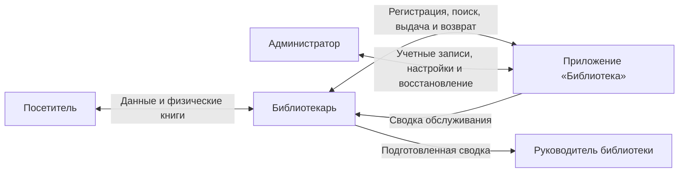

# Лабораторная работа № 2

**Дисциплина:** «Разработка и анализ требований»  
**Документ:** образ и границы проекта  
**Приложение:** «Библиотека»  
**Вариант:** разработка клиентской и серверной части приложения «Библиотека. Регистрация посетителя, выдача книг посетителю»  
**Год:** 2026

---

## Содержание

1. [Бизнес-требования](#1-бизнес-требования)
   - [Исходные данные](#11-исходные-данные)
   - [Возможности бизнеса](#12-возможности-бизнеса)
   - [Бизнес-цели и критерии успеха](#13-бизнес-цели-и-критерии-успеха)
   - [Потребности клиента или рынка](#14-потребности-клиента-или-рынка)
   - [Бизнес-риски](#15-бизнес-риски)
   - [Анализ рынка](#16-анализ-рынка)
2. [Образ решения](#2-образ-решения)
3. [Масштабы и ограничения проекта](#3-масштабы-и-ограничения-проекта)
4. [Бизнес-контекст](#4-бизнес-контекст)
5. [Контекстная диаграмма](#контекстная-диаграмма)

---

> **Цель работы:** ознакомиться с правилами составления документа об образе и границах проекта при анализе требований на этапе системного анализа и разработать такой документ для приложения «Библиотека».
> **Результат работы:** определены бизнес-требования, назначение продукта, основные функции, границы первой версии и условия эксплуатации.

## 1. Бизнес требования

### 1.1 Исходные данные

Проект предназначен для автоматизации обслуживания посетителей небольшой библиотеки. В качестве исходной ситуации рассматривается учет в бумажных формулярах и отдельных электронных таблицах. Библиотекарь вручную регистрирует посетителя, проверяет наличие книги, записывает выдачу и дату возврата. При работе нескольких сотрудников сведения приходится сверять между рабочими местами.

Такой порядок усложняет поиск читательской карточки и определение того, у кого находится конкретный экземпляр. Возможны повторная регистрация одного посетителя, пропуск записи о возврате и выдача книги по устаревшим сведениям. Эти проблемы особенно заметны при одновременном обслуживании нескольких посетителей.

Предлагается клиент-серверное приложение с единой базой данных. Клиентская часть предоставляет сотрудникам интерфейс регистрации и книговыдачи. Серверная часть проверяет права и правила обслуживания, обрабатывает операции и сохраняет общие данные. Посетитель после регистрации учитывается в системе как читатель.

Основные объекты учета: читатель, библиографическая запись книги, физический экземпляр, выдача и учетная запись сотрудника. Название книги и ее экземпляр различаются: у одного издания может быть несколько экземпляров с разными инвентарными номерами.

Для уточнения требований предусматриваются следующие способы сбора информации:

- Интервью с библиотекарем: выяснить обязательные данные читателя, порядок выдачи, ограничения и причины отказа.
- Анализ документации: изучить читательский формуляр, журнал выдачи и действующие правила пользования библиотекой.
- Наблюдение за обслуживанием: зафиксировать последовательность действий и измерить время регистрации и выдачи.
- Анкетирование сотрудников и посетителей: определить, какие задержки и ошибки мешают обслуживанию.

### 1.2 Возможности бизнеса

Единый учет позволит сократить время поиска и повторный ввод данных. Библиотекарь сможет сразу увидеть доступные экземпляры, текущие выдачи читателя и просроченные возвраты. Руководитель получит сведения о количестве регистраций и выдач за выбранный период.

Для библиотеки ценность проекта состоит в ускорении обслуживания и уменьшении ошибок учета. Доход от продажи приложения не является целью. Для получения ожидаемого результата потребуются актуальные сведения о фонде, подключение рабочих мест к локальной сети и обучение сотрудников.

### 1.3 Бизнес цели и критерии успеха

Показатели ниже задаются как плановые цели проекта. Исходные значения необходимо измерить до внедрения. Результат оценивается после двух недель опытной эксплуатации; сокращение времени сравнивается на одинаковых сценариях и сопоставимом объеме данных.

| код | цель | Критерий успеха и проверка |
| --- | --- | --- |
| БЦ01 | Ускорить регистрацию посетителя | Снизить медианное время регистрации не менее чем на 30%. Сравнить не менее 30 операций до и после внедрения. |
| БЦ02 | Ускорить выдачу книг | Снизить медианное время выдачи одного экземпляра не менее чем на 25%. Сравнить не менее 30 операций для уже зарегистрированных читателей. |
| БЦ03 | Сократить ошибки учета | Не допустить двух активных выдач одного экземпляра. В 100 контрольных операциях выдачи и возврата нет расхождений между карточкой читателя и статусом экземпляра. |
| БЦ04 | Обеспечить полноту учета | Каждая выдача содержит читателя, экземпляр, сотрудника, дату выдачи и срок возврата. Проверить все записи за период опытной эксплуатации. |
| БЦ05 | Упростить контроль возвратов | Список просроченных выдач формируется без ручной сверки и совпадает с контрольной выборкой не менее чем из 20 записей. |

На достижение целей влияют качество исходных данных, обучение библиотекарей и исправность локальной сети. Команда разработки управляет проверками данных, удобством сценариев и надежностью сохранения. Подготовка фонда и организация работы сотрудников зависят от библиотеки.

### 1.4 Потребности клиента или рынка

Основные пользователи первой версии — библиотекари и администратор системы. Библиотекарю нужны быстрый поиск читателя, понятная регистрационная форма и оформление выдачи без повторного заполнения сведений. Администратору необходимы управление учетными записями сотрудников, настройка правил и восстановление данных.

Посетителю важно быстро зарегистрироваться и получить достоверную информацию о наличии книги и сроке возврата. В первой версии он взаимодействует с библиотекарем; самостоятельный вход посетителя в приложение не предусматривается. Руководитель получает подготовленную библиотекарем сводку обслуживания.

Типичный сценарий: посетитель сообщает данные для регистрации; библиотекарь проверяет наличие карточки и при необходимости создает ее. Затем находит книгу, выбирает доступный экземпляр и подтверждает выдачу. Система фиксирует операцию, а сотрудник сообщает посетителю срок возврата.

Интерфейс должен использовать привычные термины «читатель», «книга», «экземпляр», «выдача» и «возврат». Ошибка должна объяснять причину отказа и возможное действие сотрудника. Требования к отклику и нагрузке приведены в разделе 4.3.

### 1.5 Бизнес риски

Оценка вероятности является качественной: низкая, средняя или высокая. Потери описаны через последствия для обслуживания, поскольку денежная оценка и бюджет проекта не установлены. Управляемость показывает, насколько команда может снизить риск своими действиями.

| Риск | Вероятность | Возможные потери | Управляемость и меры |
| --- | --- | --- | --- |
| Р01 Некачественные исходные данные | Высокая | Ошибочная выдача, повторные карточки, дополнительные часы на сверку. | Частичная. Проверить данные перед вводом; предупреждать о возможных дубликатах; сверить инвентарные номера. |
| Р02 Ошибки одновременной выдачи | Средняя | Один экземпляр закреплен за двумя читателями; конфликт при обслуживании. | Высокая. Выполнять выдачу атомарно; проверять доступность на сервере; испытать одновременные запросы. |
| Р03 Сбой сервера или потеря данных | Средняя | Остановка обслуживания; необходимость восстанавливать историю выдач. | Частичная. Ежедневное резервное копирование, отдельное хранение копий и проверка восстановления. |
| Р04 Непринятие системы сотрудниками | Средняя | Параллельный учет в разных местах; ожидаемое ускорение не достигнуто. | Частичная. Согласовать основные сценарии, подготовить краткую инструкцию и провести обучение. |
| Р05 Расширение объема проекта | Высокая | Задержка сдачи; незавершенные основные сценарии. | Высокая. Зафиксировать версию 1.0; бронирование и личный кабинет отложить; оценивать изменения до включения. |
| Р06 Доступ без разрешения | Средняя | Раскрытие данных читателей, изменение записей и снижение доверия. | Высокая для программных мер. Проверять роли на сервере, защищать пароли, регистрировать значимые действия; библиотека ограничивает доступ к оборудованию. |

При отказе от автоматизации сохраняются затраты времени на ручную сверку и риск потери бумажных записей. При этом внедрение само по себе не исправит неверные сведения о фонде: предварительная сверка остается обязанностью библиотеки.

Наибольшее внимание требуется рискам Р01, Р02 и Р03, так как они непосредственно влияют на достоверность выдач. Перед опытной эксплуатацией необходимо проверить уникальность инвентарных номеров, конкурентную выдачу одного экземпляра и восстановление из резервной копии.

### 1.6 Анализ рынка

Для сравнения рассмотрены специализированные библиотечные системы Koha и ИРБИС64, а также учет в электронных таблицах. Возможности специализированных систем проверены по официальной документации [2–4]. Оценка их соответствия небольшому учебному проекту является аналитическим выводом.

| Решение | Возможности и преимущества | Ограничения для данного проекта |
| --- | --- | --- |
| Koha | Ведение читателей, выдача и возврат книг, настройка правил обслуживания. Готовые процессы регистрации и книгооборота [2, 3]. | Потребуется развертывание и настройка существующей системы. Освоение ее возможностей шире задачи разработки двух основных сценариев. |
| ИРБИС64 | Автоматизация каталогизации, читательского поиска, книговыдачи и администрирования. Поддерживает комплекс библиотечных процессов [4]. | Нужны подбор конфигурации и обучение. Часть возможностей находится за рамками регистрации и выдачи; условия приобретения уточняются отдельно. |
| Электронные таблицы | Доступный и привычный способ хранить список читателей и книг; легко начать учет без отдельной разработки. | В обычном файле без дополнительной автоматизации проверки выдачи, права и согласованность записей приходится обеспечивать вручную. |
| Приложение «Библиотека» | Единая база, рабочие сценарии регистрации, выдачи и возврата; возможность адаптировать формы к одной библиотеке. | Нужно самостоятельно реализовать проверки, резервное копирование и сопровождение; функциональность первой версии ограничена. |

Koha и ИРБИС64 уже решают задачи библиотечного учета, поэтому создание нового продукта нельзя обосновать отсутствием аналогов. Разработка оправдана учебной целью — спроектировать клиентскую и серверную части — и возможностью получить небольшой продукт под согласованные правила конкретной библиотеки.

Предполагаемое отличие приложения состоит в узком объеме первой версии и формах, ориентированных на повседневное обслуживание. Это преимущество требует проверки на сотрудниках: небольшой набор функций не гарантирует удобства сам по себе. Если библиотеке понадобится комплексная автоматизация комплектования и каталогизации, следует повторно сравнить собственную разработку с внедрением готовой системы.

Сравнение не устанавливает превосходство по цене или производительности: для этого потребуются коммерческие предложения, оценка затрат на сопровождение и испытания в одинаковых условиях.

## 2. Образ решения

### 2.1 Положение об образе проекта

Для библиотекарей небольшой библиотеки, которым необходимо быстро регистрировать посетителей и достоверно учитывать выдачу книг, приложение «Библиотека» является клиент-серверной информационной системой. Оно обеспечивает общее хранилище читателей, экземпляров и выдач. В отличие от разрозненных бумажных формуляров и таблиц, продукт предоставляет актуальные сведения всем рабочим местам и проверяет возможность выдачи перед сохранением операции.

### 2.2 Основные функции

Функции имеют постоянные идентификаторы Ф01–Ф11. Их номера используются при определении состава версий и связывании функций с бизнес-целями.

| Код | Функция | Ожидаемый результат |
| --- | --- | --- |
| Ф01 | Вход и разграничение прав | Сотрудник работает под личной учетной записью; сервер проверяет полномочия. |
| Ф02 | Регистрация посетителя | Создана карточка читателя с уникальным номером; обязательные поля проверены; возможные дубликаты отмечены. |
| Ф03 | Поиск и изменение карточки | Читатель найден по номеру или ФИО; контакты исправлены; карточка может быть деактивирована. |
| Ф04 | Учет книг и экземпляров | Сохранены сведения об издании, инвентарный номер и статус каждого экземпляра. |
| Ф05 | Поиск книг | Сотрудник находит книгу по названию или автору и видит доступность экземпляров. |
| Ф06 | Выдача книги | Сервер проверяет читателя и экземпляр, сохраняет выдачу и срок возврата без конфликтов. |
| Ф07 | Регистрация возврата | Активная выдача закрыта; экземпляр снова доступен; повторный возврат отклонен. |
| Ф08 | Контроль текущих выдач | Видны книги у читателя, сроки возврата и список просроченных выдач. |
| Ф09 | История и журнал действий | Сохраняется история выдач и возвратов; значимые изменения связаны с сотрудником. |
| Ф10 | Простая сводка обслуживания | Библиотекарь получает число регистраций и выдач за выбранный период для руководителя. |
| Ф11 | Администрирование | Администратор управляет сотрудниками и правилами; выполняет резервное копирование и восстановление. |

Связь с бизнес-целями: БЦ01 поддерживают Ф02 и Ф03; БЦ02 — Ф03, Ф05 и Ф06; БЦ03 — Ф04, Ф06, Ф07 и Ф09; БЦ04 — Ф06 и Ф09; БЦ05 — Ф08. Ф01 и Ф11 обеспечивают условия безопасной и устойчивой работы.

### 2.3 Предположения и зависимости

Предполагается обслуживание одной библиотеки без филиалов. Сотрудники работают в одном здании и используют общую локальную сеть. Каждому экземпляру присвоен уникальный инвентарный номер. Библиографические сведения и информация о читателях вводятся вручную; массовый перенос из сторонних систем в первую версию не входит.

Обязательные сведения при регистрации — ФИО, дата рождения и один контакт для связи. Отчество указывается при наличии. Номер читателя формируется системой. Совпадение ФИО и даты рождения вызывает предупреждение, но не автоматический отказ: разные люди могут иметь одинаковые данные. Состав полей подтверждается библиотекой до разработки.

Для планирования приняты правила: не более пяти одновременно выданных экземпляров на читателя и срок выдачи 14 календарных дней. Неактивному читателю, а также читателю с просроченной выдачей новая книга не выдается; возврат разрешен. Эти параметры являются предположениями и должны быть согласованы с заказчиком; лимит и срок настраиваются администратором.

Проект зависит от готовности каталога и реестра экземпляров, наличия серверного оборудования и локальной сети, а также участия библиотекарей в проверке сценариев. Библиотека определяет правила обработки и хранения данных читателей; разработчик обеспечивает предусмотренные проектом средства защиты.

## 3. Масштабы и ограничения проекта

### 3.1 Объем первоначально запланированной версии

Версия 1.0 включает Ф01–Ф11. Основной результат — завершенный цикл: регистрация читателя, поиск доступного экземпляра, выдача, просмотр задолженности и возврат. Учет каталога, экземпляров и сотрудников необходим для работы этого цикла; комплексная автоматизация всех подразделений библиотеки не предусматривается.

Клиентская часть содержит формы входа, читателей, каталога, выдачи и возврата, просмотра истории и простой сводки. Серверная часть выполняет проверку прав и правил, хранит общие данные и обеспечивает согласованность операций. Копирование и восстановление могут выполняться штатными средствами сервера, без отдельного сложного интерфейса.

Система должна сохранять историю завершенных операций. Удаление читателя или экземпляра, на который ссылается история, не допускается; вместо этого запись переводится в неактивное состояние. Экземпляр с активной выдачей нельзя деактивировать до регистрации возврата.

Версия считается готовой после проверки полного цикла обслуживания, отказа при недоступном экземпляре, одновременной выдачи, ограничений читателя, разграничения прав и восстановления данных. Целевые показатели качества приведены в разделе 4.3; показатели пользы для библиотеки — в разделе 1.3.

### 3.2 Объем последующих версий

Сроки последующих выпусков отсчитываются от приемки версии 1.0 и являются предварительными. Состав версий уточняется по отзывам сотрудников и доступным ресурсам.

| Версия | Желательный срок | Планируемые возможности |
| --- | --- | --- |
| 1.1 | Через 1–2 месяца | Продление срока выдачи, печатный читательский билет и документ о выдаче, экспорт списков для сотрудников. |
| 1.2 | Через 3–4 месяца | Личный кабинет читателя, просмотр собственных выдач, бронирование доступных книг и уведомления о сроке возврата. |
| 2.0 | Через 6–12 месяцев | Работа с несколькими филиалами, использование сканеров штрихкодов и обмен данными с внешним каталогом. |

Личный кабинет потребует отдельной роли читателя и проверки доступа только к его данным. Для уведомлений понадобится внешний сервис отправки сообщений. Перед внедрением филиалов потребуется пересмотреть модель мест хранения и перемещения экземпляров. Эти зависимости не входят в обязательства первой версии.

### 3.3 Ограничения и исключения

Организационные границы версии 1.0: одна библиотека, единый фонд и работа сотрудников в локальной сети. Посетитель не управляет собственной карточкой и не оформляет выдачу самостоятельно. Физическую передачу и прием книги выполняет библиотекарь; система фиксирует их результат.

В первую версию не включаются:

- бронирование, продление сроков, личный кабинет, автоматические сообщения посетителям и печать билетов;
- денежные штрафы, платежи, бухгалтерский учет и расчет компенсаций за утрату книг;
- закупка и комплектование фонда, списание по актам и межбиблиотечный абонемент;
- хранение и чтение электронных книг, рекомендательная система и отдельное мобильное приложение;
- интеграции со сторонними каталогами, RFID, сканерами и государственными информационными системами;
- автономная работа клиента без связи с сервером и последующая синхронизация данных.
Система не подтверждает личность посетителя по внешним источникам и не проверяет физическое состояние книги автоматически. Эти действия остаются частью работы сотрудника. Ограничения нагрузки из раздела 4.3 задают объем испытаний; работа за их пределами требует отдельной оценки.

Запрос на новую функцию оценивается по влиянию на сроки, надежность и основную цель. Если функция не нужна для регистрации и учета выдач, ее по умолчанию планируют на последующий выпуск.

## 4. Бизнес контекст

### 4.1 Профили заинтересованных лиц

| Участник | Ценность и интерес | Отношения и ограничения |
| --- | --- | --- |
| Библиотекарь | Быстрее находит читателя и книгу, оформляет выдачу и возврат. Заинтересован в Ф02–Ф10. | Положительное при удобном интерфейсе; возможна настороженность к смене привычного учета. Нужны обучение и минимальный повторный ввод. |
| Посетитель | Быстрое обслуживание, достоверный срок возврата и отсутствие ошибочной задолженности. | Положительное при сокращении ожидания. В версии 1.0 работает через библиотекаря; важна конфиденциальность данных. |
| Руководитель библиотеки | Контроль обслуживания и просроченных выдач; сводные показатели для оценки работы. | Заинтересован в пользе и соблюдении срока. Получает сводку от библиотекаря; отдельного интерфейса руководителя в версии 1.0 нет. |
| Администратор | Управление доступом, настройками и восстановлением; интерес к Ф01 и Ф11. | Заинтересован в надежности и понятном сопровождении. Нужны доступ к серверу и регламент резервного копирования. |
| Разработчик | Определенные границы и проверяемые требования к клиенту и серверу. | Заинтересован в согласованных сценариях. Зависит от качества исходных данных и своевременной обратной связи. |

### 4.2 Приоритеты проекта

| Параметр | Категория | Правило управления |
| --- | --- | --- |
| Функции и объем | Ключевой фактор | Обязателен полный цикл регистрации, выдачи и возврата. Дополнительные возможности переносятся в следующие версии. |
| Качество | Ключевой фактор | Достоверность выдач, права доступа и сохранность данных обязательны; ими нельзя компенсировать задержку. |
| График | Ограничение | Первая версия должна быть подготовлена к согласованному сроку сдачи учебного проекта. |
| Затраты | Степень свободы | Допускается выбирать подходящие бесплатные инструменты и использовать имеющееся оборудование; расходы оцениваются отдельно. |
| Кадры | Ограничение | Разработка выполняется одним студентом; постоянное расширение команды не предполагается. |

При сокращении срока упрощается интерфейс и откладываются расширения. Проверки выдачи, возврата, доступа и восстановления сохраняются. Несовместимость срока с обязательным объемом требует пересогласования срока или границ версии.

### 4.3 Операционная среда

Рабочие места находятся в одном здании и часовом поясе. Данные вводятся и используются в этой библиотеке; объединение нескольких фондов не требуется. Планируемый режим — часы работы библиотеки. Круглосуточный публичный доступ в первой версии не нужен.

Клиент работает в браузере на компьютере сотрудника. Сервер приложения и СУБД размещаются на выделенном компьютере или сервере библиотеки. Сервер обрабатывает запросы клиента и обращается к общей базе; прямой доступ клиентских рабочих мест к СУБД не предоставляется. Постоянное подключение к Интернету для основных сценариев не требуется.

| Характеристика | Целевое требование и проверка |
| --- | --- |
| Масштаб данных | До 5 000 читателей, 10 000 экземпляров и 100 000 записей выдач; до 5 одновременных сотрудников. Это плановая нагрузка первой версии. |
| Время отклика | Не менее 95% запросов поиска и сохранения выполняются за 2 секунды или быстрее в локальной сети. Проверить на плановом объеме данных при 5 одновременных пользователях. |
| Доступность | Не менее 99% времени в рабочие часы за месяц, включая остановки обслуживания. Рассчитывать по журналу недоступности; для учебного прототипа это эксплуатационная цель. |
| Целостность | Изменения выдачи и статуса экземпляра сохраняются как одна операция. Один экземпляр имеет не более одной активной выдачи; возврат закрывает только существующую активную выдачу. |
| Безопасность | Индивидуальные учетные записи, роли библиотекаря и администратора, серверные проверки полномочий, защищенное соединение и хранение паролей в виде стойких хешей. |
| Восстановление | Резервная копия ежедневно после окончания работы на отдельном носителе. Допустимая потеря данных — до одного рабочего дня; целевое время восстановления — до 4 часов. Проверить пробным восстановлением. |
| Удобство | Русскоязычный интерфейс, обозначение обязательных полей, понятные сообщения об ошибках. После инструктажа сотрудники должны выполнять основные сценарии без помощи разработчика. |

Клиентская проверка помогает сотруднику исправить ввод, но окончательное решение принимает сервер. При одновременном запросе на один экземпляр успешна только одна выдача; второй сотрудник получает сообщение о недоступности. Если ответ сервера потерян, повторное подтверждение той же операции не должно создавать новую выдачу.

При отсутствии связи с сервером новые операции не фиксируются. После восстановления соединения сотрудник проверяет результат последней операции, прежде чем повторять ее. Обход правил через изменение данных в клиенте недопустим.

## Контекстная диаграмма

Диаграмма показывает приложение как единый процесс и внешних участников, обменивающихся с ним данными. Клиентская часть, сервер и база находятся внутри границы системы и не являются отдельными внешними участниками.

*Рисунок 1 — Контекстная диаграмма приложения «Библиотека»*

Потоки посетителя обозначают логический обмен данными через библиотекаря, а не самостоятельный доступ к клиенту. Руководитель получает сводку от сотрудника и поэтому не имеет отдельного прямого потока. Физические книги передаются между библиотекарем и посетителем вне приложения.

