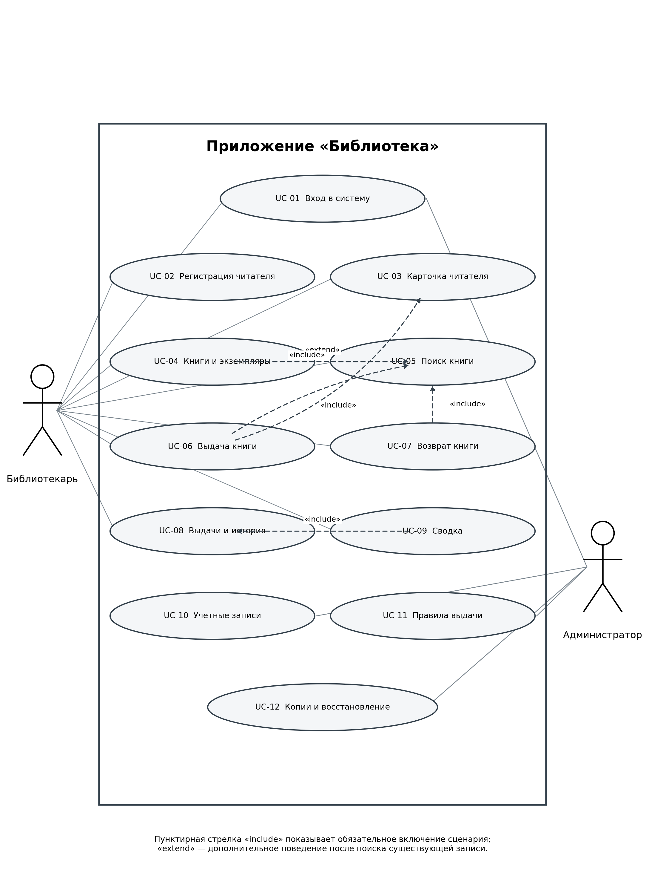
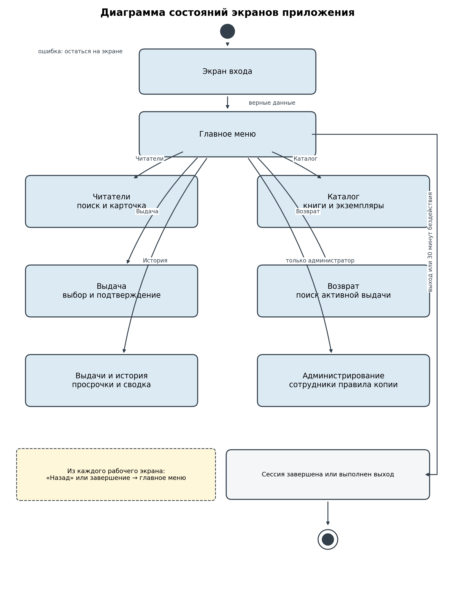
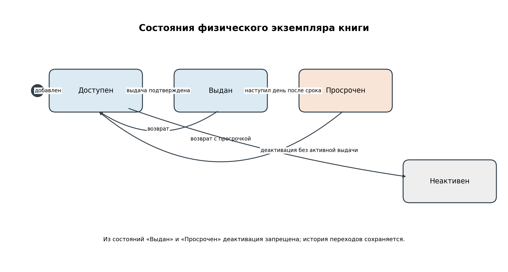

# Лабораторная работа № 4

# 1 Цель и постановка задачи

**Цель работы:** разработать модели пользовательских требований к клиент-серверному приложению «Библиотека» в нотации UML.

**Задача:** построить диаграмму основных вариантов использования, модель состояний экранов и модель состояний важного объекта предметной области.

Модели уточняют раздел 3 и приложение 2 спецификации требований. Они показывают, кто работает с системой, какие задачи выполняются, между какими экранами переходит сотрудник и как изменяется состояние физического экземпляра книги.

# 2 Исходные элементы модели

## 2.1 Действующие лица

| Код | Действующее лицо | Ответственность |
| --- | --- | --- |
| ACT-01 | Библиотекарь | Регистрирует читателей, ведет фонд, ищет книги, оформляет выдачу и возврат, просматривает историю и просрочки. |
| ACT-02 | Администратор | Управляет учетными записями сотрудников, правилами выдачи, резервным копированием и восстановлением. |

Посетитель является участником библиотечного обслуживания, но не прямым пользователем приложения: собственная учетная запись и самостоятельный вход для него не предусмотрены.

## 2.2 Основные объекты и процессы

| Объект или процесс | Назначение | Связанные сценарии |
| --- | --- | --- |
| Читатель | Карточка зарегистрированного посетителя, контакты, активность и история обслуживания. | UC-02, UC-03, UC-08 |
| Издание и экземпляр | Описание книги и учет конкретной физической копии по инвентарному номеру. | UC-04, UC-05 |
| Выдача | Связь читателя с экземпляром, сроком возврата и сотрудниками, выполнившими операции. | UC-06, UC-07, UC-08 |
| Учетная запись | Учетная запись с полномочиями библиотекаря либо администратора. | UC-01, UC-10 |
| Правила и резервные копии | Лимит, срок выдачи и средства восстановления общей базы данных. | UC-11, UC-12 |

# 3 Результаты проектирования

В соответствии с заданием графические модели вынесены в приложение 2. В нем представлены диаграмма вариантов использования со связями между сценариями, модель состояний экранов и модель жизненного цикла экземпляра. Таблицы после каждой диаграммы расшифровывают ее элементы и переходы.

| Модель | Назначение | Раздел приложения 2 |
| --- | --- | --- |
| Диаграмма Use Case | Показывает двух актеров, доступные функции и связи include и extend. | П2.1 |
| Диаграмма состояний экранов | Показывает переходы пользователя между входом, меню и рабочими разделами. | П2.2 |
| Диаграмма состояний экземпляра | Показывает изменение доступности физической книги при выдаче, просрочке и возврате. | П2.3 |

# Приложение 2 Модели анализа

## П2.1 Модель действий пользователей

Диаграмма Use Case фиксирует границу приложения, доступ актеров к функциям и повторное использование сценариев. В системе предусмотрены два действующих лица: библиотекарь работает с обслуживанием читателей и фондом, а администратор выполняет служебные операции. Вход в систему доступен обеим ролям.

*Рисунок 1 — Диаграмма основных вариантов использования приложения «Библиотека»*

**Связи вариантов использования:** UC-06 обязательно включает выбор карточки читателя UC-03 и поиск доступного экземпляра UC-05; UC-07 включает поиск экземпляра UC-05; UC-09 использует данные UC-08; UC-04 расширяет поиск UC-05 редактированием выбранной записи.

### П2.1.1 Расшифровка вариантов использования

| Код | Вариант использования | Актер | Результат |
| --- | --- | --- | --- |
| UC-01 | Вход в систему | Библиотекарь и администратор | Сотрудник подтверждает личность и получает доступ к действиям своей роли. |
| UC-02 | Регистрация посетителя | Библиотекарь | Библиотекарь создает карточку нового читателя и получает его уникальный номер. |
| UC-03 | Поиск и изменение карточки читателя | Библиотекарь | Библиотекарь находит существующую карточку и актуализирует ее сведения или активность. |
| UC-04 | Ведение книг и экземпляров | Библиотекарь | Библиотекарь поддерживает каталог изданий и перечень физических экземпляров. |
| UC-05 | Поиск книги и доступного экземпляра | Библиотекарь | Библиотекарь определяет наличие книги и выбирает экземпляр для обслуживания. |
| UC-06 | Выдача книги посетителю | Библиотекарь | Библиотекарь закрепляет выбранный экземпляр за читателем и получает срок возврата. |
| UC-07 | Возврат книги | Библиотекарь | Библиотекарь закрывает текущую выдачу фактически возвращенного экземпляра. |
| UC-08 | Просмотр выдач и истории | Библиотекарь | Библиотекарь получает текущие выдачи, просрочки и историю обслуживания. |
| UC-09 | Формирование сводки обслуживания | Библиотекарь | Библиотекарь получает число регистраций, выдач и возвратов за период. |
| UC-10 | Управление учетными записями сотрудников | Администратор | Администратор предоставляет сотрудникам доступ и прекращает его при необходимости. |
| UC-11 | Настройка правил выдачи | Администратор | Администратор изменяет лимит книг и срок выдачи для последующих операций. |
| UC-12 | Резервное копирование и восстановление | Администратор | Администратор создает согласованную копию и при необходимости восстанавливает учет. |

## П2.2 Модель сценариев работы программы

### П2.2.1 Состояния экранов

Диаграмма State Chart показывает видимые пользователю состояния интерфейса. После успешного входа сотрудник попадает в главное меню и выбирает доступный раздел. Возврат в меню не завершает сессию. Выход или 30 минут бездействия переводят приложение обратно к экрану входа.

*Рисунок 2 — Диаграмма состояний экранов и переходов пользователя*

### П2.2.2 Таблица переходов между состояниями

| Исходное состояние | Событие | Новое состояние | Действие системы |
| --- | --- | --- | --- |
| Экран входа | Ввод верных данных | Главное меню | Создается сессия с назначенной ролью. |
| Экран входа | Неверные данные | Экран входа | Показывается общий отказ, данные системы не изменяются. |
| Главное меню | Выбор раздела | Выбранный рабочий экран | Доступ проверяется по роли сотрудника. |
| Читатели | Создать или изменить карточку | Читатели | Сервер проверяет поля и сохраняет карточку. |
| Каталог | Добавить или изменить запись | Каталог | Проверяются уникальность номера и допустимость изменения. |
| Выдача | Подтвердить операцию | Главное меню или экран выдачи | При успехе создается выдача; при отказе показывается причина. |
| Возврат | Подтвердить операцию | Главное меню или экран возврата | Активная выдача закрывается либо отображается отказ. |
| Любой защищенный экран | Выход или истечение сессии | Экран входа | Сессия прекращается, дальнейшие запросы требуют входа. |

## П2.3 Состояния объекта Экземпляр

Для контроля выдачи важен жизненный цикл физического экземпляра. Изменение состояния выполняется сервером в одной транзакции с созданием либо закрытием записи выдачи.

*Рисунок 3 — Диаграмма состояний физического экземпляра книги*

| Состояние | Условие | Разрешенные переходы |
| --- | --- | --- |
| Доступен | Экземпляр активен и не имеет незакрытой выдачи. | Выдан; Неактивен. |
| Выдан | Существует активная выдача, срок еще не прошел. | Доступен после возврата; Просрочен после наступления следующего дня за сроком. |
| Просрочен | Активная выдача не закрыта после установленного срока. | Доступен после возврата. |
| Неактивен | Экземпляр исключен из обслуживания. | Новая выдача запрещена; история сохраняется. |

## П2.4 Связь моделей с требованиями

| Элемент модели | Требования | Проверяемое правило |
| --- | --- | --- |
| Вход и завершение сессии | FR-01-01–03, QA-01 | Защищенные экраны доступны только после входа и с учетом роли. |
| Регистрация и карточка читателя | FR-02-01–03, FR-03-01–04 | Карточка проверяется, получает уникальный номер и не удаляет историю. |
| Выдача и возврат | FR-06-01–05, FR-07-01–04 | Операции атомарны; один экземпляр имеет не более одной активной выдачи. |
| История и просрочки | FR-08-01–03 | Текущие и завершенные выдачи доступны по читателю и экземпляру. |
| Администрирование | FR-10-01–03, FR-11-01–02, FR-12-01–03 | Права разделены; правила версионируются; копии проверяются перед восстановлением. |

# Заключение

В работе построены UML-модели приложения «Библиотека»: диаграмма вариантов использования, диаграмма состояний экранов и диаграмма жизненного цикла экземпляра. Модели согласованы со сценариями спецификации и показывают действия сотрудников, переходы интерфейса и ограничения ключевого объекта учета.
